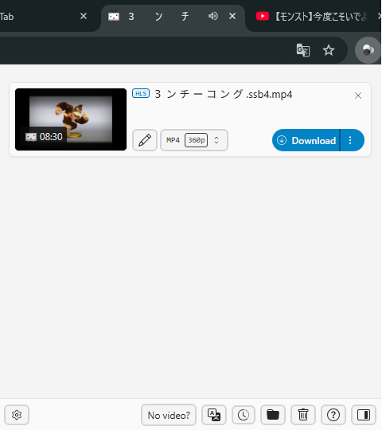
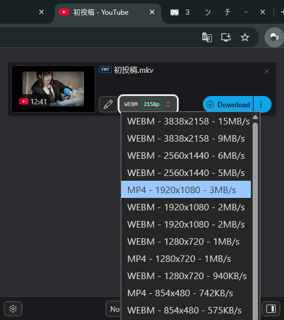

###  [日本語版はこちら](README.md)

# FreeVDH

A browser extension for downloading videos from the web.

## Overview

FreeVDH is an open-source, customized build of Video DownloadHelper ([Chrome](https://chromewebstore.google.com/detail/video-downloadhelper/lmjnegcaeklhafolokijcfjliaokphfk?hl=ja) / [Firefox](https://addons.mozilla.org/ja/firefox/addon/video-downloadhelper/)). It's a Chromium-based browser extension that detects and downloads videos on web pages.

<table><tr>
<td></td>
<td></td>
<td></td>
</tr></table>

## Features

- Automatic video detection on web pages
- Download in multiple formats and qualities
- HLS / DASH streaming download
- Support for numerous sites including YouTube
  - Twitch VOD
  - Niconico Live timeshift
- BetterSmartNaming for automatic file naming
  - Twitch: `[account_stream-title_date].mp4`
  - Niconico: `[video-title_video-id].mp4`, `[broadcaster_stream-title_date].mp4`
- Download history management
- Side panel / popup dual-mode support
- No download limits or quality restrictions

## Installation

1. Clone or download this repository
2. Open `chrome://extensions` in Chrome
3. Enable "Developer mode"
4. Click "Load unpacked" and select this folder

## License

MIT License
